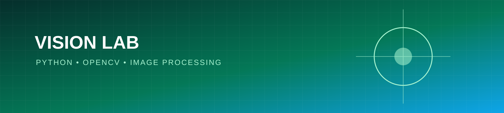

<p align="center"></p>

# Computer Vision Playground

A practical collection of computer vision experiments with Python and OpenCV, designed for learning image processing, feature extraction, and evaluation.

## Topics

- Image loading and validation
- Resizing, color spaces, and thresholding
- Edge detection and basic feature extraction
- Reproducible experiments with small datasets
- Clear limitations and evaluation notes

## Quick start

```bash
python -m venv .venv
source .venv/bin/activate  # Windows: .venv\\Scripts\\activate
pip install -r requirements.txt
python src/edges.py path/to/image.jpg
```

## Roadmap

- [ ] Add image preprocessing examples
- [ ] Add object-detection notes with responsible-use guidance
- [ ] Add metrics and a small test image set
- [ ] Add a Streamlit demonstration

## Responsible use

Do not use experiments here for biometric identification, surveillance, or high-impact decisions without proper consent, security controls, legal review, and independent validation.

## License

MIT License. See [LICENSE](LICENSE).
